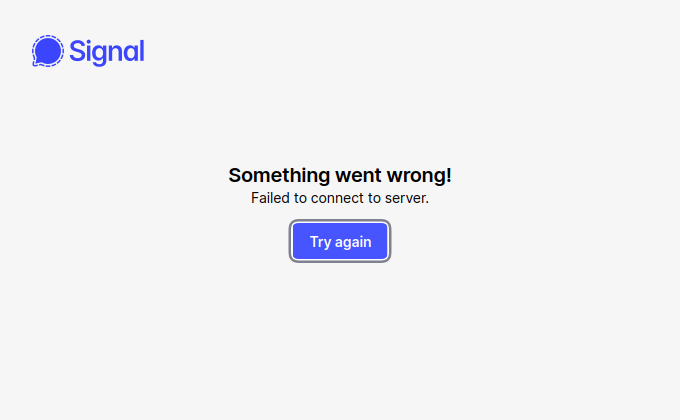
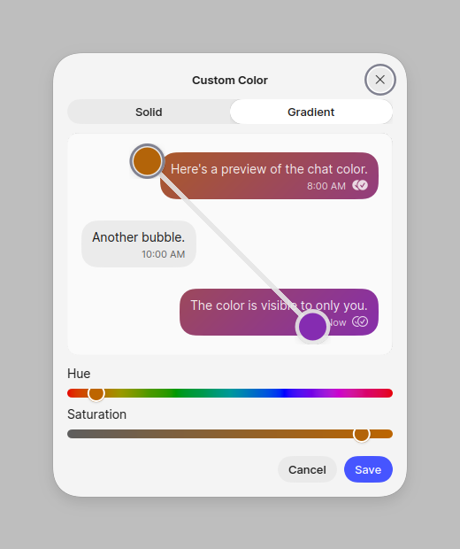
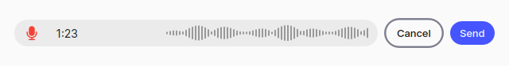

# QtSwiftUI

QtSwiftUI is a Linux implementation of part of SwiftUI for the Serein port. Applications import `SwiftUI`. Swift evaluates view bodies, tracks state and computes layout. Qt 6 Widgets supplies the window, native controls, input handling, text measurement and shape painting.


## Run the examples

From a checkout with Docker running, this command builds the Ubuntu 24.04 image, runs the tests and captures both example windows.

```sh
./Scripts/verify-linux.sh
```

Pass a Serein checkout to render its call-quality survey, chat-color picker and custom editor, media gallery, voice-note controls, data-clearing and device-link screens, leave-call dialog, call diagnostics window, device card and artwork.

```sh
./Scripts/verify-linux.sh ../serein
```

The script writes PNGs to `Screenshots/`. It compiles ten unchanged Serein source files in a temporary Swift package. The device card uses `AxoContainer`, `CSSFlex`, `CSSGrid`, `AxoTheme`, `AxoColor`, `SuperellipseRect`, `QrCode` and `QRCodeGenerator`. The sample QR encodes `qtswiftui:device-preview`. The account artwork uses `SVGPathData` and `SignalLoginIllustration`. Both fixtures were exercised with Serein revision `ae84e2b`.

The call diagnostics fixture compiles Serein’s original `CallDiagnosticWindow`, localization environment and `SignalI18n` package. A sample WebRTC report exercises the production JSON formatter. The fixture runs the production Axo button, focus ring and spinner with the original theme tokens. Portable text and glyph views stand in for Serein’s CoreText renderer and load its bundled fonts. The integration test checks that Qt selects Inter for the title. A shared Apple and Linux test checks the update order of nested dynamic properties. Its Ubuntu integration test scrolls the report, reads the German title, clicks Close and sends Escape.


The call-quality survey runs Serein’s original three-page dialog, issue selection, multiline feedback field, diagnostic link, and debug-log checkbox. Its local preview opens the production diagnostics view with a sample report and provides a sample debug log. Submitting closes the preview. No call data is sent. Shared tests use Qt and AppKit input to type two lines, activate the link, opt in to sharing, and inspect the form passed to Serein’s submission callback.


[Opening question](Screenshots/call-quality-survey.png) · [Confirmation and sharing controls](Screenshots/call-survey-confirm.png)

The 520 × 600 feedback screen differed from the macOS capture in 12,231 pixels (3.92%) at a threshold of 8/255 in any RGB channel. The preview uses the bundled Inter font for labels and each platform’s native multiline editor. Set `QTSWIFTUI_SURVEY_REFERENCE` to an existing directory to capture the same three stages with `Scripts/check-apple.sh ../serein`.

Serein’s leave-call fixture runs its unchanged `ConfirmLeaveCallModal`, `AxoConfirmDialog`, `AxoAlertDialog` and `AxoPopper`. It uses the original dialog host, panel, scrolling layout and actions. Linux omits the optional AppKit backdrop blur, which Serein disables by default. The preview uses the same portable text leaves as the diagnostics window. The Ubuntu tests click both buttons through Qt. Apple and Ubuntu tests check the panel edges, shadow and floating-layer placement. To save the Apple rendering of this fixture, set `QTSWIFTUI_DIALOG_REFERENCE` to an absolute PNG path when running `Scripts/check-apple.sh ../serein`.


The device-link fixture runs Serein’s `InstallScreenLinkInProgressStep` and `InstallScreenErrorStep` with the production Signal logo, localized text, masks, buttons and title-bar drag region. The Linux fixture routes two AppKit URL calls through `openURL` and uses a repeating Qt rotation in place of Core Animation. A test checks that the spinner advances while the Swift view graph is idle. Ubuntu tests click through all four error variants and read the combined sync announcement through Qt accessibility. Shared pixel checks cover the logo, button and progress arc. Set `QTSWIFTUI_LINK_REFERENCE` to an existing directory to capture the Apple references. Desktop window movement requires a compositor and is outside the offscreen test.




Serein’s `ClearingData` screen runs with the original progress bar in English and Arabic. The screenshot command freezes its indeterminate animation using Serein’s snapshot setting. Tests on Apple and Ubuntu check the position of the progress fill and wordmark in both languages. Both renderers mirror Serein’s vector wordmark in Arabic. The text differs with the available fallback fonts.


[Arabic rendering of the same screen](Screenshots/clearing-data-ar.png)

The empty media gallery runs Serein’s production conversation panel, four-tab header, sort menu and empty-state views. The preview owns the tab and sort bindings. Qt pointer tests select all four tabs, change the sort order, dismiss the menu and activate Back. An accessibility test opens the same menu with Qt’s Press action, changes the selection with Toggle and checks the exposed checkbox states. Both renderers check the tab labels at window widths of 520 and 1,200 points. The portable font renderer produces small differences around the text and icons. The 520 × 440 media view differs from the Apple capture in 3,959 pixels at a threshold of 8/255 in any RGB channel (1.73%).


[Audio tab with its sort menu open](Screenshots/media-gallery-sort.png)

The populated Media tab runs Serein’s `AttachmentSection`, `MediaGridLayout`, `MediaGridItem` and `ImageOrBlurhash` with the eight entries from its attachment-section capture. Its PNG and BMP decoders supply the pixels. The preview retains Serein’s `PixelImage` fitting, snapping and animation code and draws its buffer through a resizable SwiftUI image in place of the Metal shader. Checkouts without the upstream cat screenshot use Serein’s bundled cat GIF frame. Tests on Ubuntu and macOS check three, four and five columns. Qt tests exercise opening a photo, returning to the gallery, toggling the sample download state and sorting by size. The 520 × 440 capture differed from macOS in 7,583 pixels at the same 8/255 threshold (3.31%). Set `QTSWIFTUI_GALLERY_REFERENCE` to an existing directory to save the macOS captures.


The chat-color picker runs the complete Serein `ChatColorPicker`, including its message preview, 22 presets, custom swatch menu and reset-confirmation dialog. The preview starts with the four colors from Serein’s picker tests and keeps edits in memory. Both platforms exercise selecting a preset, editing a custom color, saving or canceling, duplicating and deleting a swatch, and confirming or canceling a reset. The reset rows use the production Axo item layouts and trigger registration. Serein’s reset-alert Cancel also calls the environment dismiss action, which closes this standalone window on both platforms. The custom editor’s Cancel returns to the picker. The fixture omits unused avatar and mixed-inline section-title views. At 780 × 720, 27,208 pixels (4.84%) differ from the AppKit-hosted SwiftUI capture by more than 8/255 in any RGB channel. Set `QTSWIFTUI_PICKER_REFERENCE` to an existing directory to capture the picker and its open menu during the tests.


The custom chat-color example runs Serein’s production editor dialog, gradient dial, sample message bubbles, timestamp and delivery indicators, hue and saturation sliders, and Save and Cancel buttons. It uses the orange and purple endpoints and 135-degree angle from Serein’s gradient-editing fixture, with a fixed clock for the messages. Native pointer tests on both macOS and Ubuntu select the purple endpoint, edit its hue, save the gradient, switch to Solid and save again. A separate test drags positioned sibling controls in a named coordinate space. The preview uses the same portable text leaves as the other Serein examples.



Set `QTSWIFTUI_EDITOR_REFERENCE` to an absolute PNG path when running `Scripts/check-apple.sh ../serein` to capture the static SDK reference. At 520 × 620, 8,685 pixels (2.69%) differ from the Ubuntu capture by more than 8/255 in any RGB channel.

Serein’s voice-note recorder runs with sample peaks and a fixed 1:23 timer. The production code supplies its waveform, buttons, one-hour timeout and discard dialog. Ubuntu substitutes a SwiftUI scene-phase change for the single AppKit deactivation notification that saves the draft. The tests exercise draft saving, cancellation of the timeout when a recording is replaced, and the timeout callback on Apple and Ubuntu. Qt also receives native clicks, focused Escape, and the two discard-dialog actions. The fixture supplies the recording data and captures the Send callback.



[Discard draft dialog on Ubuntu](Screenshots/discard-recording.png)

The recorded voice-note draft uses Serein’s original play/pause button and waveform bars. Click the waveform to seek. The preview advances the playback clock over sample levels. A shared test checks spatial tap locations in AppKit and Qt, and Linux tests select four playback positions through native pointer events. Qt device-event tests cover touch, touchpad, stylus and mouse masks. Physical touch and tablet hardware remain unverified.


Serein’s original slider accepts pointer drags, Home, End, arrow keys, and Qt accessibility Increase and Decrease actions. Drag events in a 140 × 80 window reached the same start and end locations in AppKit and Qt in local, global, and named coordinate spaces. The velocity estimate comes from native pointer samples. Exact velocity and prediction parity remains unverified.


The key transparency fixture renders the original illustration declaration from Serein’s onboarding dialog in both color schemes. The dialog itself uses AppKit. The artwork exercises transformed clips, even-odd fills and round stroke caps.


On a Linux desktop with Swift 6.2, `pkg-config` and `qt6-base-dev` installed, run `swift run Conversation` or `swift run Controls`. Qt selects the desktop platform plugin. For headless rendering, set `QT_QPA_PLATFORM=offscreen` and `QTSWIFTUI_SCREENSHOT` to a writable PNG path. `QTSWIFTUI_CAPTURE_DELAY_MS` allows time for asynchronous content before capture.

## Use the library

For a client package alongside this checkout, add `.package(path: "../QtSwiftUI")` to the package dependencies. This product dependency on the app target lets the same source use Apple's SDK on macOS.

```swift
.product(name: "SwiftUI", package: "QtSwiftUI", condition: .when(platforms: [.linux]))
```

## Compatibility and verification

The target is source compatibility with Apple's public SwiftUI APIs. The implementation is partial. The conversation and preferences windows are standalone examples. Serein's complete SignalUI target and app still require more SwiftUI APIs and Linux replacements for direct Apple framework dependencies, including CoreText and AppKit.

| Area | Exercised behavior |
| --- | --- |
| App and views | A single window, view builders, custom views, conditional content and keyed collections |
| Model data | State survives row reordering, bindings edit text, observable models invalidate the view, typed environment injection |
| Layout | Stacks, frames, padding, scrolling, geometry, size proposals, placement and custom layout values used by Serein. Preferences reduce in view-tree order after layout. Anchors position Serein’s floating content in a geometry reader. |
| Controls and rendering | Buttons and custom pressed-state styles, check boxes, text fields, sliders, text, colored surfaces and paths painted by Qt |
| Bitmap images | CGImage-backed SwiftUI images with scale, eight orientations, padded RGB/RGBA rows, cap insets, tiling, aspect fit and aspect fill. Shared SDK tests exercise nearest-neighbor sampling. Qt uses bilinear filtering for the other interpolation levels. |
| Graphics | Linear gradients as views, shape fills and Canvas shading. Canvas fills and strokes, even-odd paths, gradient stops, affine transforms and path hit testing. The Linux CoreGraphics module supplies geometry for these APIs. |
| Animation | Cubic timing curves interpolate opacity, offsets, rotation angles and trimmed shapes. A shared fixture exercises Serein’s original Axo progress ring. Rotation currently affects painting, while native mouse hit regions retain the unrotated geometry. |
| Links and pointer input | Link activation, accessible link labels, custom URL handling, Qt tooltips and hover callbacks. Ubuntu uses the desktop URL handler for system actions. |
| Scrolling | Native Qt scrolling updates scroll geometry observers. Apple and Ubuntu tests scroll 240 points of content through an 80-point viewport and check old and new values as the offset crosses a threshold. |
| Keyboard input | Programmatic composer focus, native focus changes, sending with Return, Escape commands and selectable monospaced diagnostic text. |
| Lifecycle | An async view task updates an observable model while the Qt event loop runs. An on-change handler observes the result. A timeline also advances to a scheduled date inside the Qt event loop. |

`./Scripts/check-apple.sh ../serein` type-checks the example source with Apple's SwiftUI module on a Mac with Xcode. `./Scripts/check-api.sh` extracts public symbol graphs from Xcode and the Linux image. Pass `--missing` to list missing declaration paths. The inventory groups declarations by symbol kind and path, counts overload spellings separately, and excludes underscored and synthesized members. A shared name alone cannot establish matching signatures, constraints, availability or behavior.

The inventory against the macOS 27.2 SDK found 1,091 shared declaration paths out of 7,627 and 659 identical declaration spellings out of 8,735. The examples exercise a smaller set at runtime. Navigation, multiwindow scenes, broader animation support, text shaping parity, gestures and platform integration remain substantial gaps. Font metrics, control appearance and several layout behaviors differ from Apple's implementation.

After capturing the Linux examples, run `./Scripts/compare-artwork.sh ../serein` on macOS to render both illustrations with Apple's `ImageRenderer`. At a threshold of 8/255 in any RGB channel, 101 of 119,680 account artwork pixels (0.084%) and 91 of 49,928 key transparency pixels (0.182%) differed. The mean absolute channel differences were 0.104/255 and 0.095/255 respectively. Both reference images are saved in `.build/artwork/`.

The diagnostics package also compiles Serein’s complete `AxoShadow.swift` and generated token definitions. A test draws a clipped, blurred box shadow using its production modifier. Six grayscale samples through the shadow were 0, 90, 143, 201, 244 and 255 on Qt. Apple produced 245 at the fifth sample and matched the other five.

The calling fixture also compiles Serein’s original `CallingAudioIndicator`, SVG parser and icon table. Tests compare the speaking bars’ path bounds on Apple and Ubuntu and sample their pixels during a 200 ms audio-level animation in Qt.

The same package runs Serein’s `AxoChatDateSection` inside a native scroll view. The Apple and Linux tests measure a 204-point scroll, and a separate pixel test checks nested visual offsets, opacity and sibling drawing order. The scrolled label is visible in the Ubuntu capture. The macOS offscreen view cache captures the underlying document at that location, so the live header’s pixel parity remains unverified.

Serein’s production HSL color slider uses explicit device-RGB interpolation for its track. Apple and Ubuntu tests sample the hue stops in both layout directions. The Qt test drags the thumb and invokes accessible increment and decrement. Shared rendering tests also check SwiftUI’s default perceptual gradient, type-erased shape styles, linear-light Canvas shading, and repeated and mirrored gradients.

The gallery fixtures compile Serein’s segmented control, including its spring-driven selection indicator. Tests compare matched position, size and anchor placement with Apple’s renderer, and follow a moving indicator across two Qt button labels. Binding tests exercise explicit transactions and spring trajectories. Full animation-transition and clipping parity remains open.

The call-lobby fixture compiles Serein’s original hidden microphone and video shortcut buttons. Native Qt key events exercise Shift+M and Shift+V. Tests also cover duplicate shortcuts in view order, disabled controls, toggles, removal and reassignment. Button styles read their assigned shortcut on Apple and Ubuntu. On Linux, `.command` maps to Meta, `.control` to Ctrl and `.option` to Alt. International keyboard-layout remapping and the Caps Lock and Function modifiers remain unverified.

The framework reference is [Apple's SwiftUI documentation](https://developer.apple.com/documentation/swiftui).
