# QtSwiftUI

QtSwiftUI is a Linux implementation of part of SwiftUI for the Serein port. Applications import `SwiftUI`. Swift evaluates view bodies, tracks state and computes layout. Qt 6 Widgets supplies the window, native controls, input handling, text measurement and shape painting.


## Run the examples

From a checkout with Docker running, this command builds the Ubuntu 24.04 image, runs the tests and captures both example windows.

```sh
./Scripts/verify-linux.sh
```

Pass a Serein checkout to render its inbox, Calls tab, New Call picker, call history, call-link details, participant approval, contact details and note, About window, nickname editor, call settings, data usage settings, call-quality survey, screen-sharing picker, chat-color picker and custom editor, media gallery, photo lightbox, sticker manager and pack preview, username QR card, disappearing-message timer, voice-note controls, data-clearing and device-link screens, leave-call dialog, call diagnostics window, device card and artwork.

```sh
./Scripts/verify-linux.sh ../serein
```

The script writes PNGs to `Screenshots/`. It compiles ten unchanged Serein source files in a temporary Swift package. The device card uses `AxoContainer`, `CSSFlex`, `CSSGrid`, `AxoTheme`, `AxoColor`, `SuperellipseRect`, `QrCode` and `QRCodeGenerator`. The sample QR encodes `qtswiftui:device-preview`. The account artwork uses `SVGPathData` and `SignalLoginIllustration`. Both fixtures were exercised with Serein revision `ae84e2b`.

The call diagnostics fixture compiles Serein’s original `CallDiagnosticWindow`, localization environment and `SignalI18n` package. A sample WebRTC report exercises the production JSON formatter. The fixture runs the production Axo button, focus ring and spinner with the original theme tokens. Portable text and glyph views stand in for Serein’s CoreText renderer and load its bundled fonts. The integration test checks that Qt selects Inter for the title. A shared Apple and Linux test checks the update order of nested dynamic properties. Its Ubuntu integration test scrolls the report, reads the German title, clicks Close and sends Escape.

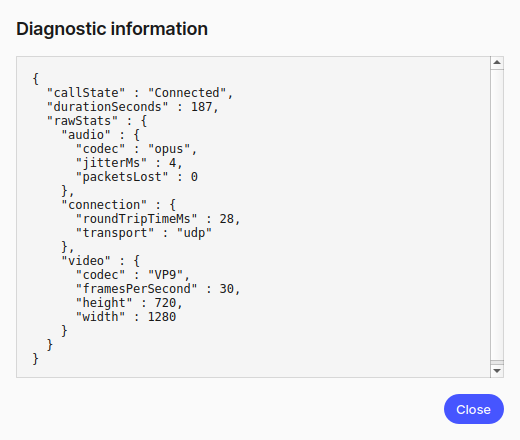

The call-quality survey runs Serein’s original three-page dialog, issue selection, multiline feedback field, diagnostic link, and debug-log checkbox. Its local preview opens the production diagnostics view with a sample report and provides a sample debug log. Submitting closes the preview. No call data is sent. Shared tests use Qt and AppKit input to type two lines, activate the link, opt in to sharing, and inspect the form passed to Serein’s submission callback.

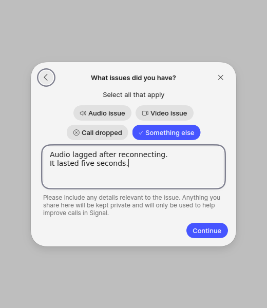

[Opening question](Screenshots/call-quality-survey.png) · [Confirmation and sharing controls](Screenshots/call-survey-confirm.png)

The 520 × 600 feedback screen differed from the macOS capture in 11,144 pixels (3.57%) at a threshold of 8/255 in any RGB channel. The preview uses the bundled Inter font for labels and each platform’s native multiline editor. Set `QTSWIFTUI_SURVEY_REFERENCE` to an existing directory to capture the same three stages with `Scripts/check-apple.sh ../serein`.

Serein’s leave-call fixture runs its unchanged `ConfirmLeaveCallModal`, `AxoConfirmDialog`, `AxoAlertDialog` and `AxoPopper`. It uses the original dialog host, panel, scrolling layout and actions. Linux omits the optional AppKit backdrop blur, which Serein disables by default. The preview uses the same portable text leaves as the diagnostics window. The Ubuntu tests click both buttons through Qt. Apple and Ubuntu tests check the panel edges, shadow and floating-layer placement. To save the Apple rendering of this fixture, set `QTSWIFTUI_DIALOG_REFERENCE` to an absolute PNG path when running `Scripts/check-apple.sh ../serein`.

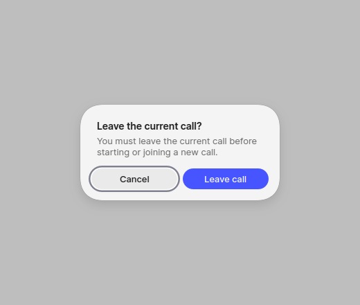

The device-link fixture runs Serein’s `InstallScreenLinkInProgressStep` and `InstallScreenErrorStep` with the production Signal logo, localized text, masks, buttons and title-bar drag region. The Linux fixture routes two AppKit URL calls through `openURL` and uses a repeating Qt rotation in place of Core Animation. A test checks that the spinner advances while the Swift view graph is idle. Ubuntu tests click through all four error variants and read the combined sync announcement through Qt accessibility. Shared pixel checks cover the logo, button and progress arc. Set `QTSWIFTUI_LINK_REFERENCE` to an existing directory to capture the Apple references. Desktop window movement requires a compositor and is outside the offscreen test.


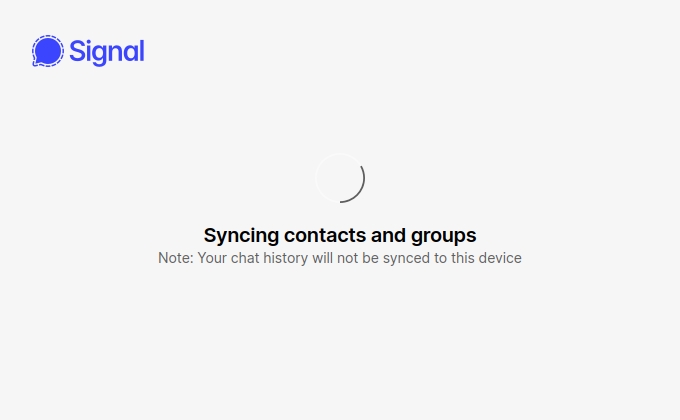

Serein’s `ClearingData` screen runs with the original progress bar in English and Arabic. The screenshot command freezes its indeterminate animation using Serein’s snapshot setting. Tests on Apple and Ubuntu check the position of the progress fill and wordmark in both languages. Both renderers mirror Serein’s vector wordmark in Arabic. The text differs with the available fallback fonts.

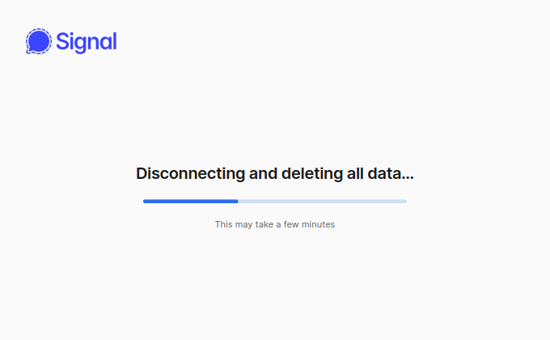

[Arabic rendering of the same screen](Screenshots/clearing-data-ar.png)

The empty media gallery runs Serein’s production conversation panel, four-tab header, sort menu and empty-state views. The preview owns the tab and sort bindings. Qt pointer tests select all four tabs, change the sort order, dismiss the menu and activate Back. An accessibility test opens the same menu with Qt’s Press action, changes the selection with Toggle and checks the exposed checkbox states. Both renderers check the tab labels at window widths of 520 and 1,200 points. The portable font renderer produces small differences around the text and icons. The 520 × 440 media view differs from the Apple capture in 3,959 pixels at a threshold of 8/255 in any RGB channel (1.73%).

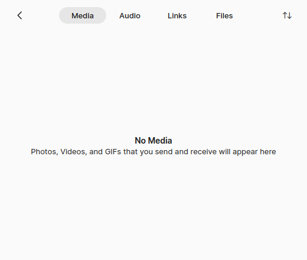

[Audio tab with its sort menu open](Screenshots/media-gallery-sort.png)

The populated Media tab runs Serein’s `AttachmentSection`, `MediaGridLayout`, `MediaGridItem` and `ImageOrBlurhash` with the eight entries from its attachment-section capture. Its PNG and BMP decoders supply the pixels. The preview retains Serein’s `PixelImage` fitting, snapping and animation code and draws its buffer through a resizable SwiftUI image in place of the Metal shader. Checkouts without the upstream cat screenshot use Serein’s bundled cat GIF frame. Tests on Ubuntu and macOS check three, four and five columns. Qt tests exercise opening a photo, returning to the gallery, toggling the sample download state and sorting by size. The 520 × 440 capture differed from macOS in 7,583 pixels at the same 8/255 threshold (3.31%). Set `QTSWIFTUI_GALLERY_REFERENCE` to an existing directory to save the macOS captures.

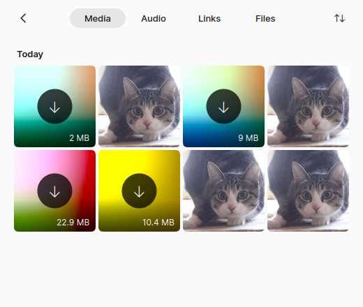

The `--lightbox` example runs the photo mode of Serein’s `Lightbox` and its original `LightboxZoomableImage`. It opens the lighthouse JPEG from the Signal Desktop fixtures when present, and also works with Serein’s bundled cat photo. The populated gallery opens this viewer when you select a downloaded photo. Both platforms use the same SwiftUI raster adapter for Serein’s Metal image shader. Save and Forward open local preview dialogs. Video playback is outside this example.

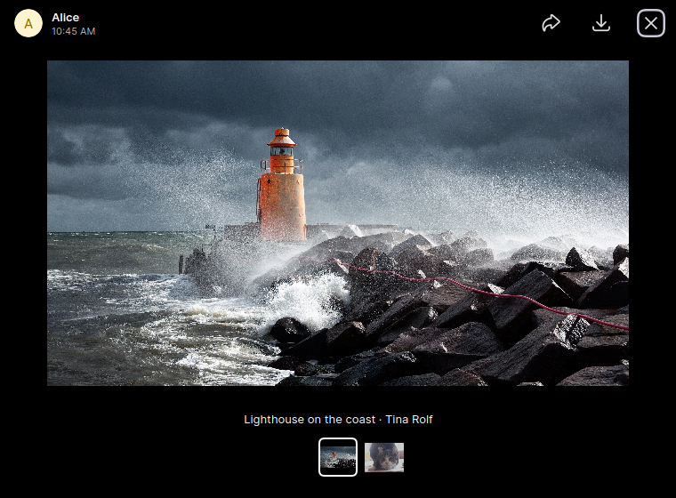

[View the full-resolution zoom on Ubuntu](Screenshots/lightbox-zoomed.png). Tests send pinch events through Qt and AppKit, compare scale, recognition threshold, initial velocity and gesture coordinates, then exercise click-to-zoom, thumbnail selection, Save and Close. Qt tests also move the pointer across the enlarged image and check both zoom cursors. Set `QTSWIFTUI_LIGHTBOX_REFERENCE` to an existing directory when running `Scripts/check-apple.sh` to save the macOS captures.

The `--username-card` example displays Serein’s branded username QR card for its `alice.42` fixture. The production exporter uses `ImageRenderer.cgImage`, Serein’s pixel conversion, and its PNG encoder to save a 1272 × 1728 card at 300 dpi. The example shares the card’s layout, font settings and QR generator with the exporter. Word and grapheme widths come from Qt on Linux and CoreText on macOS. Both exports decoded to the fixture link with Apple Vision. The Ubuntu export differed from Apple’s by a mean of 0.57/255 per RGB channel.

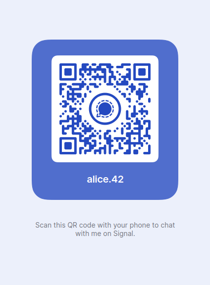

[Full-resolution Ubuntu PNG](Screenshots/username-card.png)

The integration tests write the production PNG when `QTSWIFTUI_USERNAME_REFERENCE` names an existing directory. The Apple check also scans the Ubuntu export in `Screenshots/` when present.

The `--typing` example opens the group conversation with Serein’s `TypingBubble` and `TypingAnimation`. Four contacts from its upstream story are typing. The newest three avatars and a +1 overflow badge appear beside the animated dots. Selecting an avatar opens that person’s local contact dialog. `--still` freezes the dots for repeatable captures.

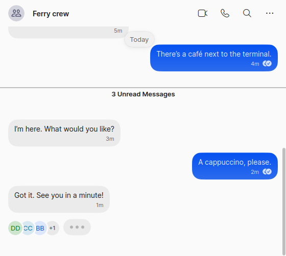

Apple and Ubuntu tests click all three avatars and check the IDs passed by Serein. Opacity transition tests sample the fade in both directions. A deterministic Qt clock also checks reinsertion halfway through removal. Qt retains the departing view’s clipped pixels while its native input controls are removed. Overlapping removal layers and content that changes during its exit still need parity work.

The `--conversation` example adds Serein’s production `ConversationHeader` to the message timeline. It uses the Nyah Stroman contact and kitten avatar from Serein’s header stories. Search for “tickets” and press Return to jump to that message. The contact name opens Serein’s contact dialog. The overflow menu supports local pinning, muting, changing the disappearing-message duration and opening the media panel. Call buttons dispatch local callbacks.

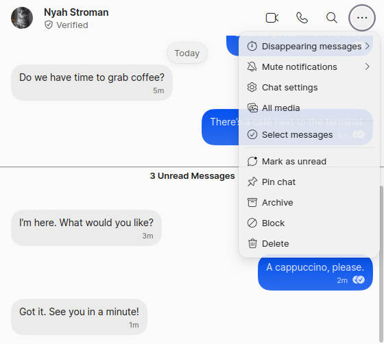

[Conversation with its header on Ubuntu](Screenshots/conversation-header.png)

Both platforms exercise the call callbacks, keyboard search, contact details and presentation of the overflow menu. Qt also exercises pin, unpin and All media through the open menu. Synthetic clicks on those menu rows did not invoke their actions in the Apple test window. Set `QTSWIFTUI_HEADER_REFERENCE` to an existing directory to save the captures. The header compiles unchanged. Its tooltip uses the example’s portable font measurement and balanced text layout.

The `--timeline` example opens Serein’s conversation timeline at the newest of eleven local messages. It compiles Serein’s production timeline, date header, unread divider and scroll buttons. The fixture provides Serein’s sample message bubble for each row. The history screenshot shows the oldest message and the button that jumps to the first unread mention.

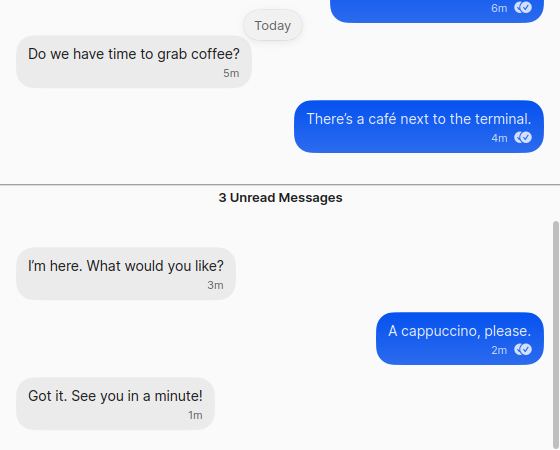

[Earlier messages and unread navigation](Screenshots/conversation-timeline-history.png)

The shared screen test observes message IDs and scroll geometry while jumping through history and clicking the mention button. Set `QTSWIFTUI_TIMELINE_REFERENCE` to an existing directory to capture both views. After a jump to the first message, Qt handles a subsequent bottom-edge command. Apple’s hosted test window continued reporting the top offset for that sequence. Both renderers support bottom-edge jumps in the fixed-height scroll tests.

The `--mute-until` example runs Serein’s unchanged `MuteUntilDialog`, calendar and three-column time picker. It opens on November 5, 2026 at 8:00 AM, using the clock and Lisbon time zone from Serein’s snapshot test. Both pickers open separate native popover windows. The hour and minute columns use `ScrollViewReader` to reveal their current values.

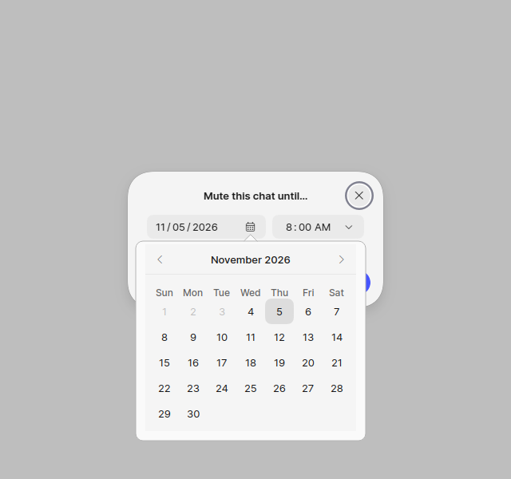

[Mute dialog](Screenshots/mute-until.png) · [9:02 PM selected in the time picker](Screenshots/mute-until-time.png)

Tests on Ubuntu and Apple SwiftUI reject a day before November 4, navigate to December, select a day, change the hour, minute and period, and check the submitted date. Presentation tests exercise all four arrow edges, point attachment, item replacement, Escape and dismissal from inside a popover. Set `QTSWIFTUI_MUTE_REFERENCE` to an existing directory to capture the open calendar and time picker. The macOS test composites the popover’s content view onto the host capture. Qt captures the popover window with its border and arrow.

The `--username-link` example runs Serein’s unchanged `UsernameLinkEditor` with a local username and link. Copy uses the system clipboard. Save opens the native file chooser and writes Serein’s printable PNG in the chosen color. Reset replaces the local fixture link after confirmation.

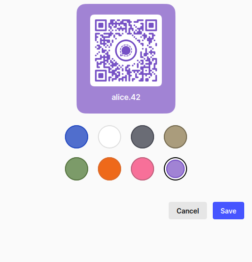

[Username link](Screenshots/username-link.png) · [Reset confirmation](Screenshots/username-link-reset.png)

Apple and Ubuntu tests click through copy, color selection, cancel, export and reset. The purple color picker differs from the Apple capture in 2,081 of 280,800 pixels by more than 8/255 in any RGB channel. Shared geometry tests exercise eager `Grid`, `GridRow`, and `AnyLayout(GridLayout())` with spans, unsized axes, cell anchors, column and row alignment, explicit guides, and right-to-left placement. Overlapping flexible spans and control-specific default spacing still need parity work.

The `--share-picker` example runs Serein’s `CallingSelectPresentingSourcesModal` with the screen and four windows from its snapshot test. Its two grids use `LazyVGrid` and four flexible `GridItem` columns. The fixture reads the original PNG thumbnails when present. A missing thumbnail displays Serein’s warning icon. Selecting a source enables Start sharing and passes its ID to the local callback. Desktop capture is outside this example.

Tests on Apple and Ubuntu choose a screen, switch to a window, submit a source with a missing thumbnail, and exercise both dismiss buttons. In the 840 × 620 selected-window capture, the mean absolute RGB difference from the Apple rendering was 1.84/255. Both renderers truncate the long window title with an ellipsis. Thumbnail sampling and card shadows still differ. Set `QTSWIFTUI_SHARE_REFERENCE` to an existing directory to capture the picker during tests.

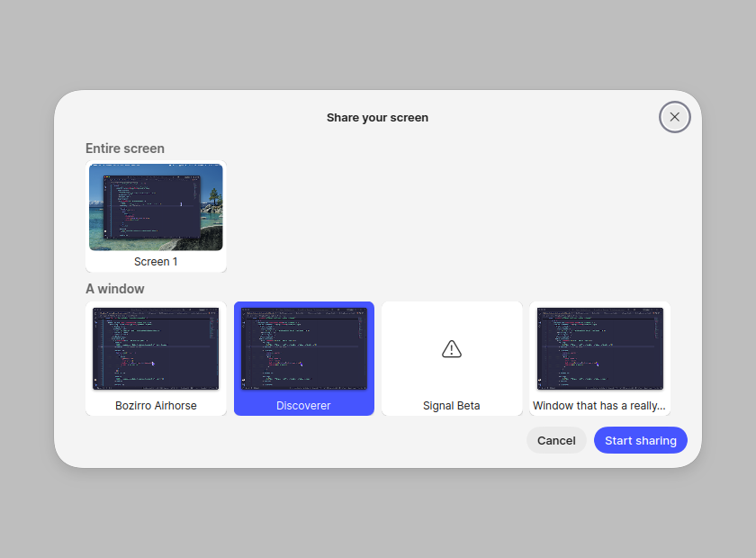

The `--stickers` example runs Serein’s `StickerManager`, `StickerPreviewModal`, and uninstall confirmation with its sticker-manager test packs. Right-click a pack to add or remove it, or click its row to open the preview. Changes last for the lifetime of the example. The preview uses three kitten images from the desktop fixtures and falls back to Serein’s bundled cat frame when those images are absent. Qt supplies the native context menu and clipboard. The shared text adapter draws the two-line caption on the preview’s stacked buttons.

Tests on Ubuntu and macOS install from both the context menu and the preview. They check that canceling uninstall keeps a shared pack and confirming it removes the pack. Nested context menus select the innermost available commands on both platforms. At 600 × 460, the pack preview differed from the Apple capture in 6,995 pixels (2.53%) by more than 8/255 in any RGB channel. Set `QTSWIFTUI_STICKER_REFERENCE` to an existing directory to capture these screens during tests.

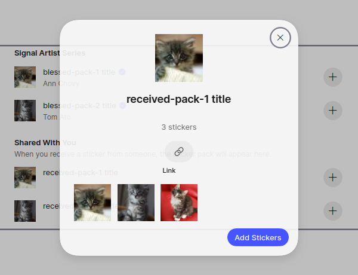

[Sticker manager](Screenshots/stickers.png) · [Native context menu](Screenshots/stickers-context-menu.png) · [Uninstall confirmation](Screenshots/sticker-uninstall.png)

The `--disappearing-timer` example opens Serein’s `DisappearingTimeDialog` with its original `Select` controls. The example starts at 45 minutes. On Ubuntu, each control opens a native Qt menu. The same interaction test uses AppKit’s menu on macOS and verifies that switching to weeks caps the selection at four, that two weeks submits 1,209,600 seconds, and that Cancel leaves the saved value alone. The explanatory text wraps differently on the two systems. Set `QTSWIFTUI_TIMER_REFERENCE` to an existing directory to capture the macOS dialog.

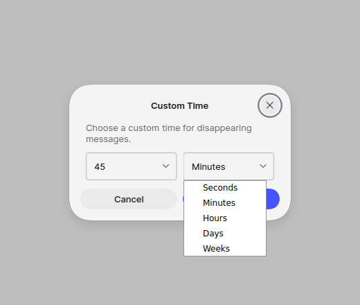

The chat-color picker runs the complete Serein `ChatColorPicker`, including its message preview, 22 presets, custom swatch menu and reset-confirmation dialog. The preview starts with the four colors from Serein’s picker tests and keeps edits in memory. Both platforms exercise selecting a preset, editing a custom color, saving or canceling, duplicating and deleting a swatch, and confirming or canceling a reset. The reset rows use the production Axo item layouts and trigger registration. Serein’s reset-alert Cancel also calls the environment dismiss action, which closes this standalone window on both platforms. The custom editor’s Cancel returns to the picker. The fixture omits unused avatar and mixed-inline section-title views. At 780 × 720, 27,208 pixels (4.84%) differ from the AppKit-hosted SwiftUI capture by more than 8/255 in any RGB channel. Set `QTSWIFTUI_PICKER_REFERENCE` to an existing directory to capture the picker and its open menu during the tests.

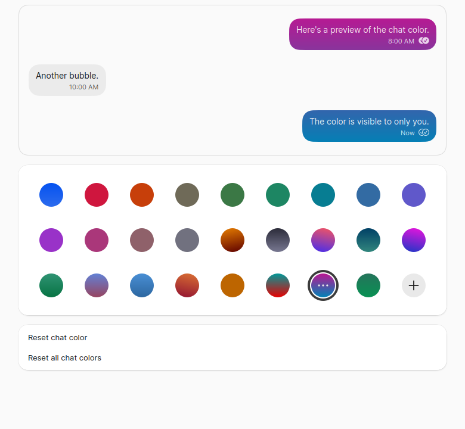

The custom chat-color example runs Serein’s production editor dialog, gradient dial, sample message bubbles, timestamp and delivery indicators, hue and saturation sliders, and Save and Cancel buttons. It uses the orange and purple endpoints and 135-degree angle from Serein’s gradient-editing fixture, with a fixed clock for the messages. Native pointer tests on both macOS and Ubuntu select the purple endpoint, edit its hue, save the gradient, switch to Solid and save again. A separate test drags positioned sibling controls in a named coordinate space. The preview uses the same portable text leaves as the other Serein examples.


Set `QTSWIFTUI_EDITOR_REFERENCE` to an absolute PNG path when running `Scripts/check-apple.sh ../serein` to capture the static SDK reference. At 520 × 620, 8,685 pixels (2.69%) differ from the Ubuntu capture by more than 8/255 in any RGB channel.

Serein’s voice-note recorder runs with sample peaks and a fixed 1:23 timer. The production code supplies its waveform, buttons, one-hour timeout and discard dialog. Ubuntu substitutes a SwiftUI scene-phase change for the single AppKit deactivation notification that saves the draft. The tests exercise draft saving, cancellation of the timeout when a recording is replaced, and the timeout callback on Apple and Ubuntu. Qt also receives native clicks, focused Escape, and the two discard-dialog actions. The fixture supplies the recording data and captures the Send callback.


[Discard draft dialog on Ubuntu](Screenshots/discard-recording.png)

The call-history preview compiles Serein’s `CallsList`, search field, avatars, call buttons, missed filter and localized timestamps. It uses eight sample records and a fixed clock. The preview filters those records in memory. The tests select calls, search by name, receive Join and Create a Call Link callbacks, and select the last call after scrolling. The standalone pane has no calling service or persistent history.

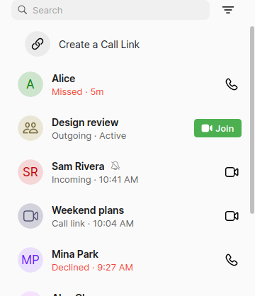

The `--calls-tab` example runs the complete Serein `CallsTab` and `NavSidebar`. Drag the divider to resize the sidebar, select a missed call to mark it as read, or open New Call to search the sample contact directory. Starting a call displays the contact and call type locally. The More menu opens Serein’s clear-history confirmation. Clear removes the sample history and its call links. Cancel preserves them and invokes the environment dismiss action, closing the standalone window.

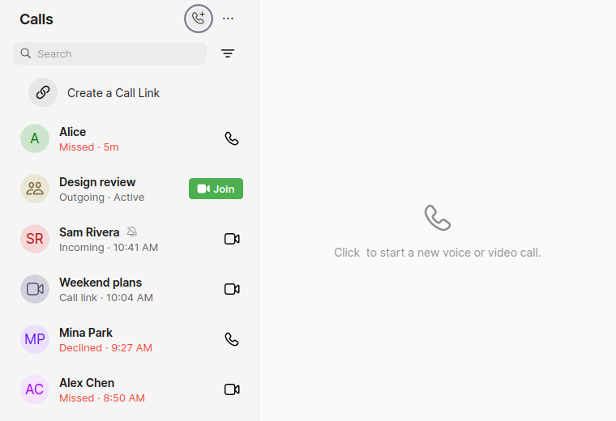

[New Call picker](Screenshots/new-call.png) · [More menu](Screenshots/calls-menu.png) · [Clear-history confirmation](Screenshots/clear-call-history.png)

Shared tests exercise mouse resizing, keyboard resizing in both writing directions, call selection, contact search, and both confirmation actions. Qt tests also check the divider cursor and the accessible increment action. Layout tests switch between horizontal, vertical and custom layouts, verify child state survives each switch, and check that copies of a type-erased layout cache update independently. Set `QTSWIFTUI_CALLS_REFERENCE` to an existing directory to capture the same four screens with `Scripts/check-apple.sh ../serein`. The mean absolute RGB difference from Apple was 2.41/255 for Calls and 0.68/255 for New Call at 760 × 520. Both captures show a gap where the English empty-state caption expects an inline phone icon.

The `--inbox` example runs Serein’s `Inbox` and `NavTabs` with the Calls tab, empty chat list and call settings panels. Its unread badge uses Serein’s own horizontal and vertical alignment guides. Shared tests switch tabs, collapse and restore the rail, and open the call-link manager. Layout tests check explicit guide propagation, custom alignment IDs, and badge placement in both writing directions. At 840 × 520 the mean absolute RGB difference from Apple was 2.20/255. Set `QTSWIFTUI_INBOX_REFERENCE` to an existing directory to capture the Apple rendering.

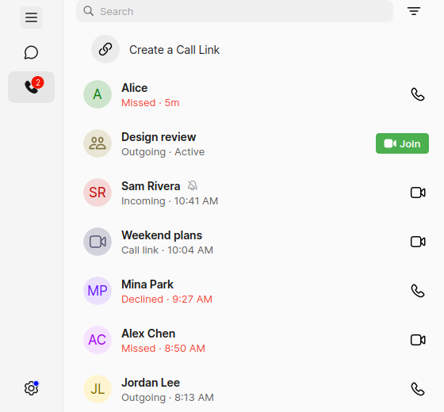

[Missed calls on Ubuntu](Screenshots/call-history-missed.png). Set `QTSWIFTUI_HISTORY_REFERENCE` to an existing directory when running the Apple checks to capture both reference states.

Selecting Weekend plans in call history opens Serein’s call-link details. Create a Call Link opens its management dialog with a local sample link. The standalone `--call-link` example uses the admin link and four history entries from Serein’s tests. Rename, approval and deletion change local state. Copy link writes the original URL to the clipboard. Join and Share via Signal expose callbacks for a calling service.

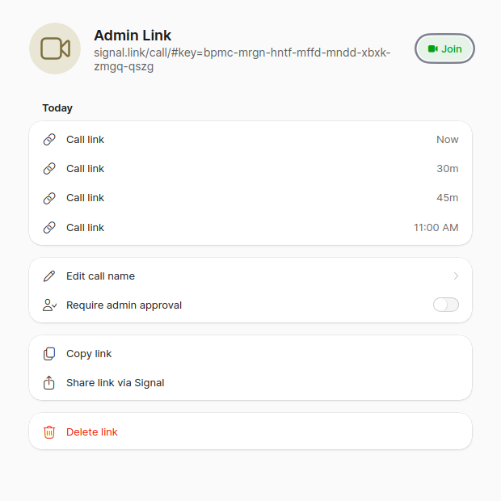

The `--nickname` example opens Serein’s nickname and note editor. Its note field grows from two to five lines, accepts multiline input, and enforces Serein’s byte and grapheme limits. Shared tests use Qt and AppKit to rename a link, cancel an edit, change the approval requirement, and save a multiline note. At their example window sizes, the mean absolute RGB difference from Apple’s rendering was 1.55/255 for call-link details and 0.88/255 for the nickname editor. Set `QTSWIFTUI_LINK_SCREENS` to an existing directory to capture the same views during Apple verification.

[Link management](Screenshots/call-link-manager.png) · [Rename dialog](Screenshots/call-link-rename.png) · [Nickname and note editor](Screenshots/nickname-and-note.png)

The `--join-request` example runs Serein’s participant approval dialog with a sample contact, a bundled avatar, and two shared groups. Qt and AppKit tests click the contact name, Approve entry, Deny entry, and Close and check the callback order. The dialog uses first-text-baseline alignment to place its name, contact emblem, and chevron. Shared layout tests cover single-line and multiline text, padding, framed text, shapes, nested stacks, and overlays. The 520 × 510 Ubuntu and Apple captures differed by 1.51/255 per RGB channel on average. The shared-group description wraps differently. Set `QTSWIFTUI_REQUEST_REFERENCE` to an existing directory for the Apple capture.

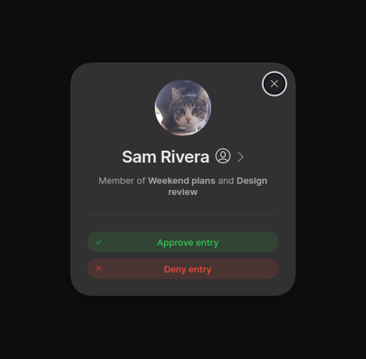

Click the participant name to open Serein’s contact details, then click its note to follow a link or edit the note. The preview retains saved edits until the window closes. The `--about-contact`, `--note-preview` and `--about` options open the contact, note and application About screens directly. These fixtures compile Serein’s dialog bodies, SignalText link detection, emoji data and bundled fonts. They send URL actions through SwiftUI’s `openURL` environment. The shared tests intercept those actions and exercise the editor with real pointer and keyboard input. The mean absolute RGB difference from the Apple captures was 1.79/255 for contact details, 2.20/255 for the note and 1.28/255 for About. Set `QTSWIFTUI_CONTACT_REFERENCE` to an existing directory to capture the Apple reference screens.

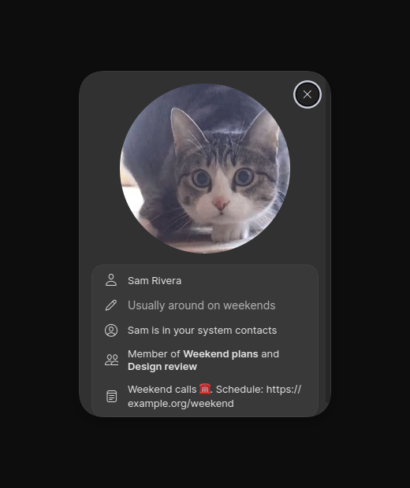

[Contact note](Screenshots/note-preview.png) · [Application About window](Screenshots/about.png)

The Calls and Data usage fixtures compile Serein’s original settings pages, scroll area, list rows, switches, and device and quality selectors. They run as standalone settings panes with Serein’s example devices. SwiftUI bindings hold the changes for the lifetime of the window. Both test suites operate all seven switches, choose devices and media quality, open the quality menu with Down Arrow, and dismiss it with an outside click. At 640 × 567, the mean absolute RGB difference from the Apple SDK rendering was 1.61/255 for Calls and 0.88/255 for Data usage. Set `QTSWIFTUI_SETTINGS_REFERENCE` to an existing directory to capture the two pages and their open menus on macOS.

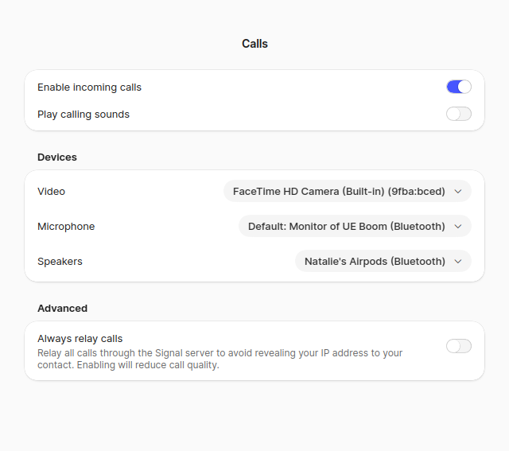

[Data usage](Screenshots/data-usage-settings.png) · [Camera menu](Screenshots/settings-camera-menu.png) · [Quality menu](Screenshots/settings-quality-menu.png)

The recorded voice-note draft uses Serein’s original play/pause button and waveform bars. Click the waveform to seek. The preview advances the playback clock over sample levels. A shared test checks spatial tap locations in AppKit and Qt, and Linux tests select four playback positions through native pointer events. Qt device-event tests cover touch, touchpad, stylus and mouse masks. Physical touch and tablet hardware remain unverified.

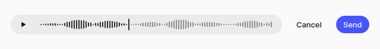

Serein’s original slider accepts pointer drags, Home, End, arrow keys, and Qt accessibility Increase and Decrease actions. Drag events in a 140 × 80 window reached the same start and end locations in AppKit and Qt in local, global, and named coordinate spaces. The velocity estimate comes from native pointer samples. Exact velocity and prediction parity remains unverified.

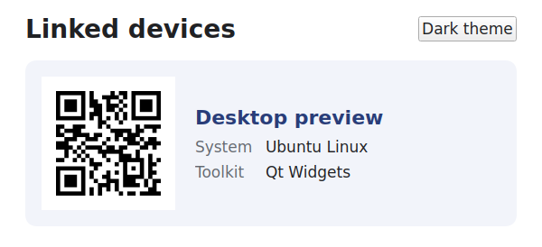


The key transparency fixture renders the original illustration declaration from Serein’s onboarding dialog in both color schemes. The dialog itself uses AppKit. The artwork exercises transformed clips, even-odd fills and round stroke caps.


On a Linux desktop with Swift 6.2, `pkg-config` and `qt6-base-dev` installed, run `swift run Conversation` or `swift run Controls`. Qt selects the desktop platform plugin. For headless rendering, set `QT_QPA_PLATFORM=offscreen` and `QTSWIFTUI_SCREENSHOT` to a writable PNG path. `QTSWIFTUI_CAPTURE_DELAY_MS` allows time for asynchronous content before capture.

## Use the library

For a client package alongside this checkout, add `.package(path: "../QtSwiftUI")` to the package dependencies. This product dependency on the app target lets the same source use Apple's SDK on macOS.

```swift
.product(name: "SwiftUI", package: "QtSwiftUI", condition: .when(platforms: [.linux]))
```

## Compatibility and verification

The target is source compatibility with Apple's public SwiftUI APIs. The implementation is partial. The conversation and preferences windows are standalone examples. Serein's complete SignalUI target and app still require more SwiftUI APIs and Linux replacements for direct Apple framework dependencies, including CoreText and AppKit.

| Area | Exercised behavior |
| --- | --- |
| App and views | A single window, view builders, custom views, conditional content and keyed collections |
| Model data | State survives row reordering, bindings edit text, observable models invalidate the view, typed environment injection |
| Layout | Stacks, frames, padding, scrolling, geometry, size proposals, placement and custom layout values used by Serein. Preferences reduce in view-tree order after layout. Anchors position Serein’s floating content in a geometry reader. |
| Controls and rendering | Buttons and custom pressed-state styles, check boxes, text fields, sliders, text, colored surfaces and paths painted by Qt |
| Text truncation | `Text.TruncationMode`, `View.truncationMode(_:)` and the environment setting control head, middle and tail truncation with an explicit line limit. Tests cover hard paragraph breaks, formatting on the final visible line and links in one-line labels. An AppKit test click on the second line of head- or middle-truncated attributed text reached the original prefix link. Qt follows the link attached to the displayed letters. Height-only truncation is unverified. |
| Image export | `ImageRenderer` renders content to an offscreen sRGB `CGImage` with natural or proposed sizing, fractional output scales and transparent or opaque backgrounds. Shared tests examine RGBA pixels and render again after a model update. Extended color modes, the Core Graphics drawing callback and Combine observation remain open. |
| Bitmap images | CGImage-backed SwiftUI images with scale, eight orientations, padded RGB/RGBA rows, cap insets, tiling, aspect fit and aspect fill. Shared SDK tests exercise nearest-neighbor sampling. Qt uses bilinear filtering for the other interpolation levels. |
| Graphics | Linear gradients as views, shape fills and Canvas shading. Canvas fills and strokes, even-odd paths, gradient stops, affine transforms and path hit testing. Canvas draws bitmap images into rectangles or at anchors and supports solid and gradient shading through a resolved image’s alpha. The Linux CoreGraphics module supplies geometry for these APIs. |
| Animation | Cubic timing curves interpolate opacity, offsets, rotation angles and trimmed shapes. A shared fixture exercises Serein’s original Axo progress ring. Rotation currently affects painting, while native mouse hit regions retain the unrotated geometry. |
| Links and pointer input | Link activation, accessible link labels, custom URL handling, Qt tooltips and continuous hover in local, global and named coordinate spaces. Ubuntu tests track the pointer over a native button, including fractional positions and exit. Both platforms verify the modified button’s geometry and click action. Hover event delivery on Apple remains unverified. Ubuntu uses the desktop URL handler for system actions. |
| View visibility and masks | Hidden views keep their layout and preferences. Both mask overloads composite the mask view’s alpha with the content in Qt. Tests move a half-transparent mask between the two edges and check hidden hit targets on both platforms. |
| Lazy grids | Fixed, flexible and adaptive columns, per-column and grid alignment, right-to-left layout, full-width section headers and footers, and on-demand rows in a scroll view. Tests compare track frames and check cell state after scrolling and changing the column count. |
| Lazy stacks | `LazyVStack` measures visible rows, estimates the remaining height and preserves state by row identity. Apple and Ubuntu tests jump between the ends of 200 rows, check retained state, and pin section headers and footers. |
| Scrolling | `ScrollViewReader` scrolls by explicit or `ForEach` ID, with an optional anchor. Shared tests move both axes, target sibling scroll views, jump to distant lazy rows and remove a target. `scrollDisabled` controls Qt wheel, scrollbar and kinetic input while leaving child actions available. Scroll views and text editors apply per-axis bounce policies to the Qt kinetic scroller. Physical trackpad and touch bounce remain unverified. Native Qt scrolling updates scroll geometry observers. Apple and Ubuntu tests scroll 240 points of content through an 80-point viewport and check old and new values as the offset crosses a threshold. |
| Adaptive layouts | `ViewThatFits` checks candidates in order, measures ideal size on the requested axes and falls back to the last child. Tests resize across breakpoints and check the chosen button, lifecycle callbacks, preference values, size and alignment guides on Ubuntu and macOS. |
| Scroll positioning | `ScrollPosition` and ID bindings move a native Qt scroll area by edge, coordinate or target. Tests cover per-role default anchors, short content, visibility thresholds, disabled target layouts and appended rows. Animated scrolling and exact visibility timing remain open. |
| Keyboard input | Programmatic composer focus, native focus changes, sending with Return, Escape commands and selectable monospaced diagnostic text. |
| Lifecycle | An async view task updates an observable model while the Qt event loop runs. An on-change handler observes the result. A timeline also advances to a scheduled date inside the Qt event loop. |

`./Scripts/check-apple.sh ../serein` type-checks the example source with Apple's SwiftUI module on a Mac with Xcode. `./Scripts/check-api.sh` extracts public symbol graphs from Xcode and the Linux image. Pass `--missing` to list missing declaration paths. The inventory groups declarations by symbol kind and path, counts overload spellings separately, and excludes underscored and synthesized members. A shared name alone cannot establish matching signatures, constraints, availability or behavior.

The inventory against the macOS 27.2 SDK found 1,382 shared declaration paths out of 7,627 and 885 identical declaration spellings out of 8,735. The examples exercise a smaller set at runtime. Navigation, multiwindow scenes, broader animation support, text shaping parity, gestures and platform integration remain substantial gaps. Font metrics, control appearance and several layout behaviors differ from Apple's implementation.

After capturing the Linux examples, run `./Scripts/compare-artwork.sh ../serein` on macOS to render both illustrations with Apple's `ImageRenderer`. At a threshold of 8/255 in any RGB channel, 101 of 119,680 account artwork pixels (0.084%) and 91 of 49,928 key transparency pixels (0.182%) differed. The mean absolute channel differences were 0.104/255 and 0.095/255 respectively. Both reference images are saved in `.build/artwork/`.

The diagnostics package also compiles Serein’s complete `AxoShadow.swift` and generated token definitions. A test draws a clipped, blurred box shadow using its production modifier. Six grayscale samples through the shadow were 0, 90, 143, 201, 244 and 255 on Qt. Apple produced 245 at the fifth sample and matched the other five.

The calling fixture also compiles Serein’s original `CallingAudioIndicator`, SVG parser and icon table. Tests compare the speaking bars’ path bounds on Apple and Ubuntu and sample their pixels during a 200 ms audio-level animation in Qt.

The same package runs Serein’s `AxoChatDateSection` inside a native scroll view. The Apple and Linux tests measure a 204-point scroll, and a separate pixel test checks nested visual offsets, opacity and sibling drawing order. The scrolled label is visible in the Ubuntu capture. The macOS offscreen view cache captures the underlying document at that location, so the live header’s pixel parity remains unverified.

The raster tests compile Serein’s `MediaEditorImageState` and `MediaEditorRenderer.drawBackground` and supply a decoded test image. Apple and Qt agree on the sampled crop bounds, horizontal flip, quarter turn, and colors inside each swatch. High-quality interpolation differs at sharp color boundaries.

Serein’s production HSL color slider uses explicit device-RGB interpolation for its track. Apple and Ubuntu tests sample the hue stops in both layout directions. The Qt test drags the thumb and invokes accessible increment and decrement. Shared rendering tests also check SwiftUI’s default perceptual gradient, type-erased shape styles, linear-light Canvas shading, and repeated and mirrored gradients.

The gallery fixtures compile Serein’s segmented control, including its spring-driven selection indicator. Tests compare matched position, size and anchor placement with Apple’s renderer, and follow a moving indicator across two Qt button labels. Binding tests exercise explicit transactions and spring trajectories. Full animation-transition and clipping parity remains open.

The call-lobby fixture compiles Serein’s original hidden microphone and video shortcut buttons. Native Qt key events exercise Shift+M and Shift+V. Tests also cover duplicate shortcuts in view order, disabled controls, toggles, removal and reassignment. Button styles read their assigned shortcut on Apple and Ubuntu. On Linux, `.command` maps to Meta, `.control` to Ctrl and `.option` to Alt. International keyboard-layout remapping and the Caps Lock and Function modifiers remain unverified.

The framework reference is [Apple's SwiftUI documentation](https://developer.apple.com/documentation/swiftui).
