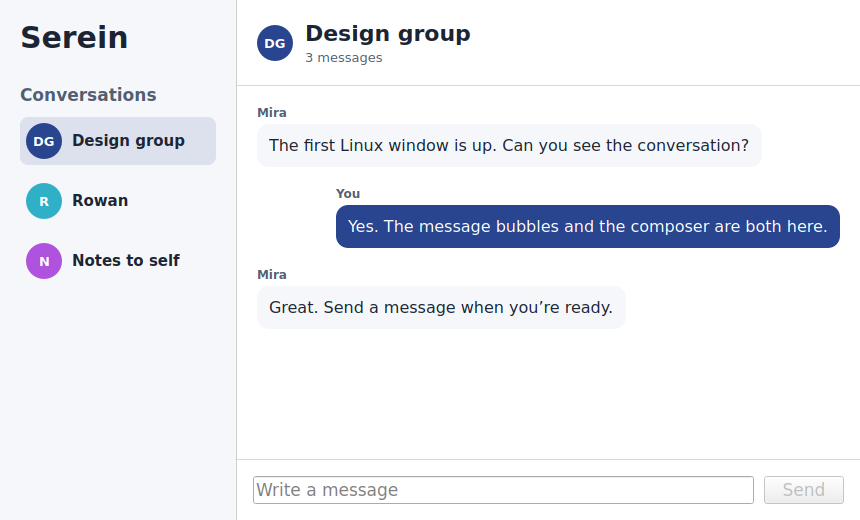
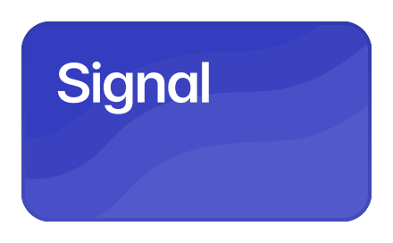

# QtSwiftUI

QtSwiftUI is a Linux implementation of part of SwiftUI for the Serein port. Applications import `SwiftUI`. Swift evaluates view bodies, tracks state and computes layout. Qt 6 Widgets supplies the window, native controls, input handling, text measurement and shape painting.



## Run the examples

From a checkout with Docker running, this command builds the Ubuntu 24.04 image, runs the tests and captures both example windows.

```sh
./Scripts/verify-linux.sh
```

Pass a Serein checkout to render its call diagnostics window, device card and account artwork.

```sh
./Scripts/verify-linux.sh ../serein
```

The script writes PNGs to `Screenshots/`. It compiles ten unchanged Serein source files in a temporary Swift package. The device card uses `AxoContainer`, `CSSFlex`, `CSSGrid`, `AxoTheme`, `AxoColor`, `SuperellipseRect`, `QrCode` and `QRCodeGenerator`. The sample QR encodes `qtswiftui:device-preview`. The account artwork uses `SVGPathData` and `SignalLoginIllustration`. Both fixtures were exercised with Serein revision `ae84e2b`.

The call diagnostics fixture compiles Serein’s original `CallDiagnosticWindow`, localization environment and `SignalI18n` package. A sample WebRTC report exercises the production JSON formatter. The fixture supplies portable versions of the CoreText title and Axo button using the original color tokens. Its Ubuntu integration test scrolls the report, reads the German title, clicks Close and sends Escape.




On a Linux desktop with Swift 6.2, `pkg-config` and `qt6-base-dev` installed, run `swift run Conversation` or `swift run Controls`. Qt selects the desktop platform plugin. For headless rendering, set `QT_QPA_PLATFORM=offscreen` and `QTSWIFTUI_SCREENSHOT` to a writable PNG path. `QTSWIFTUI_CAPTURE_DELAY_MS` allows time for asynchronous content before capture.

## Use the library

For a client package alongside this checkout, add `.package(path: "../QtSwiftUI")` to the package dependencies. This product dependency on the app target lets the same source use Apple's SDK on macOS.

```swift
.product(name: "SwiftUI", package: "QtSwiftUI", condition: .when(platforms: [.linux]))
```

## Compatibility and verification

The target is source compatibility with Apple's public SwiftUI APIs. The implementation is partial. The conversation and preferences windows are standalone examples. Serein's complete SignalUI target and app still require more SwiftUI APIs and Linux replacements for direct Apple framework dependencies, including CoreText and AppKit.

| Area | Exercised behavior |
| --- | --- |
| App and views | A single window, view builders, custom views, conditional content and keyed collections |
| Model data | State survives row reordering, bindings edit text, observable models invalidate the view, typed environment injection |
| Layout | Stacks, frames, padding, scrolling, geometry, size proposals, placement and custom layout values used by Serein |
| Controls and rendering | Buttons and custom pressed-state styles, check boxes, text fields, sliders, text, colored surfaces and paths painted by Qt |
| Graphics | Canvas fills and strokes, even-odd paths, gradient stops, affine transforms and path hit testing. The Linux CoreGraphics module supplies geometry for these APIs. |
| Keyboard input | Programmatic composer focus, native focus changes, sending with Return, Escape commands and selectable monospaced diagnostic text. |
| Lifecycle | An async view task updates an observable model while the Qt event loop runs. An on-change handler observes the result. |

`./Scripts/check-apple.sh ../serein` type-checks the example source with Apple's SwiftUI module on a Mac with Xcode. `./Scripts/check-api.sh` extracts public symbol graphs from Xcode and the Linux image. Pass `--missing` to list missing declaration paths. The inventory groups declarations by symbol kind and path, counts overload spellings separately, and excludes underscored and synthesized members. A shared name alone cannot establish matching signatures, constraints, availability or behavior.

The inventory against the macOS 27.2 SDK found 467 shared declaration paths out of 7,627 and 194 identical declaration spellings out of 8,735. The examples exercise a smaller set at runtime. Navigation, multiwindow scenes, animation, text shaping parity, gestures and platform integration remain substantial gaps. Font metrics, control appearance and several layout behaviors differ from Apple's implementation.

After capturing the Linux examples, run `./Scripts/compare-artwork.sh ../serein` on macOS to render the same account artwork with Apple's `ImageRenderer`. At 440 × 272, 641 of 119,680 pixels (0.536%) differed by more than 8/255 in any RGB channel. The mean absolute channel difference was 0.125/255. The reference image is saved in `.build/artwork/apple.png`.

The framework reference is [Apple's SwiftUI documentation](https://developer.apple.com/documentation/swiftui).
